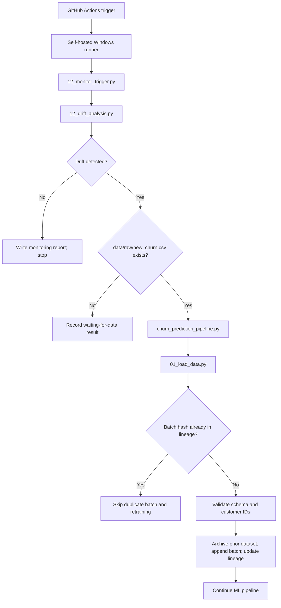
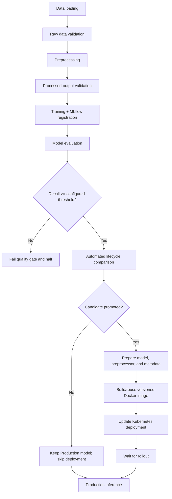

# Telco Customer Churn Prediction — End-to-End MLOps Platform

An end-to-end Machine Learning Operations (MLOps) project for predicting customer churn and demonstrating how an ML model can be validated, trained, tracked, quality-gated, versioned, monitored, and selectively deployed.

**GitHub repository:** [jnaneswar077/churn-prediction-mlops](https://github.com/jnaneswar077/churn-prediction-mlops)  
**Primary branch:** `main`  
**Project status:** Labs 1–13 integrated. The core monitoring-to-retraining workflow has been executed successfully through GitHub Actions on a self-hosted Windows runner. Scheduled execution is configured; the runner currently uses interactive mode, so the machine and runner process must remain available.

---

## Table of Contents

- [Project Overview](#project-overview)
- [Objectives](#objectives)
- [Key Capabilities](#key-capabilities)
- [Architecture](#architecture)
- [End-to-End Workflow](#end-to-end-workflow)
- [Dataset and Ingestion Rules](#dataset-and-ingestion-rules)
- [Model Evaluation and Lifecycle Policy](#model-evaluation-and-lifecycle-policy)
- [Technology Stack](#technology-stack)
- [Repository Layout](#repository-layout)
- [Environment Setup](#environment-setup)
- [Running the System](#running-the-system)
- [GitHub Actions Automation](#github-actions-automation)
- [Model Serving and Deployment](#model-serving-and-deployment)
- [Important Reports and Artifacts](#important-reports-and-artifacts)
- [Verified Integration Run](#verified-integration-run)
- [Operational Requirements and Limitations](#operational-requirements-and-limitations)
- [Troubleshooting](#troubleshooting)
- [Documentation](#documentation)
- [Security Notes](#security-notes)

---

## Project Overview

Customer churn prediction estimates whether a customer is likely to stop using a service. This repository uses a Telco Customer Churn dataset and builds an MLOps workflow around the model—not just a script that trains a classifier.

The project evolved from data preparation and a baseline Random Forest model into a modular system with schema validation, reproducible preprocessing, MLflow experiment tracking and model registration, evaluation, a recall-based quality gate, lifecycle decisions, inference, drift reporting, ingestion lineage, Docker packaging, Kubernetes deployment, and GitHub Actions automation.

A central design principle is that **a successfully trained model is not automatically a Production model**. A candidate must pass the configured quality gate and then improve on the current Production model according to the configured lifecycle decision metric. If the candidate is not promoted, the Production model remains in use and deployment is skipped.

## Objectives

- Make data preparation and model training repeatable.
- Validate raw data and processed outputs before model training.
- Track runs, evaluation metrics, artifacts, and registered model versions with MLflow.
- Prevent candidates below the configured recall threshold from reaching lifecycle promotion.
- Compare candidate and Production models before changing the live deployment.
- Track incoming dataset batches by file hash and lineage, and prevent duplicate ingestion.
- Use drift reports to decide whether the existing ML pipeline should be triggered.
- Package the serving application with Docker and manage the API deployment with Kubernetes.
- Use GitHub Actions and a self-hosted Windows runner to automate monitoring and pipeline execution.

## Key Capabilities

| Capability | Implementation |
|---|---|
| Raw-data validation | Schema and data-quality validation before downstream processing |
| Reproducible preprocessing | Scikit-learn preprocessing pipeline and fixed test-set handling |
| Experiment tracking | MLflow parameters, metrics, artifacts, and runs |
| Model registry | `Telco_Churn_Production_Model` |
| Quality gate | Configured minimum recall of `0.70` |
| Lifecycle decisions | Compare the candidate against the Production model using recall |
| Dataset versioning | SHA-256 batch hashes, archived dataset snapshots, and lineage records |
| Drift monitoring | Combine data-drift, prediction-drift, and concept-drift reports |
| Conditional retraining | Invoke the existing ML pipeline when drift and an incoming batch are present |
| Promotion-gated deployment | Skip deployment unless the lifecycle report confirms promotion |
| Model serving | FastAPI application packaged in a Docker image |
| Orchestration | Kubernetes deployment and service manifests |
| Workflow automation | GitHub Actions with a self-hosted Windows runner |
| Failure handling | Fail-fast pipeline stages and failure-injection/recovery exercises |

## Architecture

The architecture has two connected flows: the **model lifecycle pipeline** and the **monitoring/retraining trigger**.

### Monitoring and retraining flow



### Model lifecycle and deployment flow



## End-to-End Workflow

The main orchestrator is `src/mlops_pipeline/churn_prediction_pipeline.py`. Its stages are run as separate Python processes and use fail-fast behavior when a stage fails.

| Stage | Script | Responsibility |
|---|---|---|
| 1 | `01_load_data.py` | Load current data and ingest a new batch when present and not previously ingested |
| 2 | `02_validate_data.py` | Validate the raw dataset schema and constraints |
| 3 | `03_preprocessing.py` | Prepare training data and fit/persist preprocessing transformations |
| 4 | `04_validate_outputs.py` | Validate the processed outputs |
| 5 | `05_train_registry.py` | Train the model, record the MLflow run, and register the candidate |
| 6 | `06_model_evaluation.py` | Evaluate the candidate on the held-out test set |
| 7 | `07_quality_gate.py` | Enforce the configured quality threshold |
| 8 | `08_automate_lifecycle.py` | Compare candidate and Production metrics and decide whether to promote |
| 9 | `deploy_if_promoted.py` | Invoke deployment only when the lifecycle report indicates promotion |
| 10 | `09_inference.py` | Run inference using the current Production model |

If the data-loading report says `already_ingested` or `no_new_data`, the orchestrator stops early rather than retraining on unchanged data. This is expected behavior, not a pipeline failure.

## Dataset and Ingestion Rules

The primary dataset is stored at:

```text
data/raw/churn.csv
```

The current dataset snapshot recorded during the verified integration run had **7,344 rows and 21 columns**. The fixed held-out test set contained 1,409 records, leaving 5,935 training records for that run. Dataset size can change as additional valid batches are ingested.

Important fields include `customerID`, the target `Churn`, numerical attributes such as `tenure`, `MonthlyCharges`, and `TotalCharges`, and categorical attributes such as `Contract`, `InternetService`, and `PaymentMethod`.

### Incoming batch

Place an incoming batch at:

```text
data/raw/new_churn.csv
```

The batch must have the expected schema. The ingestion script validates the schema and checks that customer IDs are unique within the batch and do not overlap with IDs already present in `churn.csv`.

The ingestion process:

1. Computes the batch SHA-256 hash.
2. Checks `data/raw/archive/dataset_lineage.json` for that hash.
3. If the hash has already been ingested, writes an `already_ingested` report and skips the append/retraining path.
4. Otherwise, validates batch identity, archives the previous dataset snapshot, appends the new rows to `churn.csv`, and updates lineage and the data-load report.

This distinction matters: **a file existing on disk does not mean it represents a new batch**. The hash and lineage determine whether the batch was previously ingested.

Do not manually run `01_load_data.py` before a GitHub Actions integration test if the intention is to test that the workflow itself ingests the batch—the manual run would consume the batch first.

## Model Evaluation and Lifecycle Policy

The integrated pipeline uses a Random Forest classifier. Configuration is maintained in `config.yaml`; the README should not be treated as a substitute for the runtime configuration.

Reported evaluation metrics include:

- Accuracy
- Precision
- Recall
- F1 score
- ROC-AUC
- Confusion matrix

The quality gate is configured to require:

```yaml
quality_gate:
  metric: recall
  minimum_value: 0.70
```

The lifecycle manager uses recall as the decision metric. Passing the quality gate means that a candidate is eligible for lifecycle evaluation; it **does not** guarantee promotion. If the candidate does not improve on Production, it is archived and the Production model remains unchanged.

## Technology Stack

| Area | Tools |
|---|---|
| Language and data processing | Python, pandas, NumPy |
| Machine learning | scikit-learn, Random Forest, Joblib |
| Data validation | Pandera and project validation utilities |
| Experiment tracking and registry | MLflow |
| Configuration and reports | YAML, JSON, CSV |
| API serving | FastAPI, Uvicorn, Pydantic |
| Containerization | Docker, Docker Desktop |
| Orchestration | Kubernetes, `kubectl` |
| Automation and version control | Git, GitHub, GitHub Actions |
| Local automation host | Windows with a self-hosted GitHub Actions runner |

## Repository Layout

The following is a focused map of the main project components; some intermediate artifacts are generated at runtime.

```text
churn-prediction/
├── .github/
│   └── workflows/
│       ├── lab8_ci.yml
│       ├── lab13_monitoring.yml
│       └── lab13_runner_test.yml
├── api/
│   └── main.py
├── data/
│   ├── raw/
│   │   ├── churn.csv
│   │   ├── new_churn.csv                 # incoming batch; local/runtime input
│   │   └── archive/
│   │       ├── churn_vNN.csv
│   │       └── dataset_lineage.json
│   └── processed/
├── deployment/
│   ├── deploy_production.py
│   ├── model.pkl                          # prepared for serving
│   ├── preprocessor.pkl
│   └── model_metadata.json
├── docs/
│   ├── ARCHITECTURE.md
│   ├── LAB13_END_TO_END.md
│   ├── RUNBOOK.md
│   ├── LAB7_PIPELINE.md
│   ├── LAB8_CI_REPORT.md
│   ├── LAB9_FAILURE_HANDLING_REPORT.md
│   └── MLFLOW_CI_SETUP.md
├── k8s/
│   ├── deployment.yaml
│   └── service.yaml
├── src/
│   └── mlops_pipeline/
│       ├── 01_load_data.py
│       ├── 02_validate_data.py
│       ├── 03_preprocessing.py
│       ├── 04_validate_outputs.py
│       ├── 05_train_registry.py
│       ├── 06_model_evaluation.py
│       ├── 07_quality_gate.py
│       ├── 08_automate_lifecycle.py
│       ├── 09_inference.py
│       ├── 10_failure_injection.py
│       ├── 12_monitor_trigger.py
│       ├── 12_drift_analysis.py
│       ├── deploy_if_promoted.py
│       └── churn_prediction_pipeline.py
├── config.yaml
├── Dockerfile
├── requirements.txt
├── requirements-api.txt
└── README.md
```

## Environment Setup

The current automation is designed for the Windows development environment used by this project.

### Prerequisites

- Windows and PowerShell
- Python 3.11 (the serving container uses `python:3.11-slim`)
- Git
- Docker Desktop with Linux containers enabled
- Kubernetes enabled in Docker Desktop, plus `kubectl`
- Access to the repository and the local MLflow tracking store/artifacts

### Create a virtual environment

Run these commands from the repository root:

```powershell
python -m venv venv
.\venv\Scripts\Activate.ps1
python -m pip install --upgrade pip
python -m pip install -r requirements.txt
```

For API-only dependencies, install:

```powershell
python -m pip install -r requirements-api.txt
```

Ensure `config.yaml`, the raw dataset, the required processed split artifacts, and the expected MLflow tracking store are present before executing the corresponding pipeline stage. Do not publish credentials or a private MLflow database in the README or repository.

## Running the System

Run commands from the repository root while the intended virtual environment is active.

### Run the main MLOps pipeline

```powershell
python .\src\mlops_pipeline\churn_prediction_pipeline.py
```

Use this when you intend to process a new valid batch or run the configured pipeline. If the latest batch has already been ingested, the orchestrator intentionally stops after data loading.

### Run the monitoring and retraining trigger

```powershell
python .\src\mlops_pipeline\12_monitor_trigger.py
```

This script runs the combined drift analysis, checks whether `data/raw/new_churn.csv` exists, and decides whether to invoke the main pipeline. It writes a monitoring decision report under `outputs/monitoring/`.

### Inspect the main reports

```powershell
python -m json.tool .\artifacts\data_load_report.json
python -m json.tool .\reports\evaluation_report.json
python -m json.tool .\reports\lifecycle_report.json
python -m json.tool .\reports\deployment_automation_report.json
Get-Content .\outputs\drift\drift_analysis_report.csv
```

The paths are generated during the relevant pipeline or monitoring execution; a report may not exist until that stage has run.

## GitHub Actions Automation

The integrated monitoring workflow is:

```text
.github/workflows/lab13_monitoring.yml
```

It supports:

- `workflow_dispatch` for a manual run from GitHub Actions.
- A schedule configured for minute 17 of each hour in `Asia/Kolkata`.

The workflow targets the self-hosted runner labels `self-hosted`, `Windows`, and `X64`. It invokes the existing monitoring script instead of duplicating the MLOps logic in YAML.

### Self-hosted runner operating mode

The runner is currently configured in **interactive mode** and is started with:

```powershell
cd C:\actions-runner
.\run.cmd
```

Keep this terminal open while waiting for jobs. Scheduled runs require the PC to be awake and connected to the network, and the runner process must be listening when the workflow is due. Docker Desktop/Kubernetes must also be running for deployment or Kubernetes-dependent steps.

### Environment-specific path

The current workflow uses this project path:

```text
C:\Users\jnane\Favorites\churn-prediction
```

If the project is moved to another directory or run by another Windows user, update the workflow path accordingly. The local project and its virtual environment are prerequisites for this self-hosted workflow; this workflow is not a portable GitHub-hosted Linux job.

### Triggering a manual run

1. Open the repository on GitHub.
2. Select **Actions**.
3. Open **Lab 13 - End-to-End MLOps**.
4. Click **Run workflow** and select `main`.
5. Open the run and inspect the monitoring report and job steps.

Scheduled workflows run from the repository's default branch. A workflow definition being present on `main` makes the configured schedule eligible; actual scheduled execution still depends on the runner being online and should be observed in Actions history.

## Model Serving and Deployment

The FastAPI application is under `api/`, and the Docker image uses the `Dockerfile` and `requirements-api.txt`. The deployment preparation step obtains the current MLflow Production model and matching preprocessor, then writes a deployment bundle:

```text
deployment/
├── model.pkl
├── preprocessor.pkl
└── model_metadata.json
```

The deployment metadata records the model name/version and source run. The deployment script uses a model-version image tag such as:

```text
churn-prediction-api:model-v1
```

The deployment automation builds the image when the tag does not already exist, otherwise it reuses the local image; it then updates the Kubernetes deployment and waits for rollout completion. The promotion gate prevents an unpromoted candidate from replacing the Production service.

Useful operational commands:

```powershell
docker info
kubectl get nodes
kubectl get deployment churn-api
kubectl get pods
kubectl get service churn-api-service
kubectl get deployment churn-api -o jsonpath="{.spec.template.spec.containers[0].image}"
```

The currently configured Docker Desktop cluster and image cache are local to the host. Running the deployment on another machine requires the appropriate Docker/Kubernetes context, artifacts, and image availability.

## Important Reports and Artifacts

| Artifact | Purpose |
|---|---|
| `artifacts/data_load_report.json` | Ingestion status, row counts, and batch hash |
| `data/raw/archive/dataset_lineage.json` | Dataset batch lineage and versions |
| `data/raw/archive/churn_vNN.csv` | Archived dataset snapshots |
| `artifacts/preprocessing_summary_report.json` | Preprocessing summary |
| `reports/evaluation_report.json` | Candidate evaluation metrics |
| `reports/quality_gate_report.json` | Quality-gate result |
| `reports/lifecycle_report.json` | Candidate-versus-Production decision and promotion status |
| `outputs/drift/data_drift_report.csv` | Feature-level data drift input report |
| `outputs/drift/prediction_drift_report.csv` | Prediction/probability distribution drift report |
| `outputs/drift/concept_drift_report.csv` | Model-performance change report |
| `outputs/drift/drift_analysis_report.csv` | Combined drift decision summary |
| `outputs/monitoring/monitor_trigger_report.json` | Monitoring and retraining-trigger result |
| `logs/churn_prediction_pipeline_run_log.json` | Pipeline stage status and exit codes |
| `outputs/inference_predictions.csv` | Production inference output |
| `deployment/model_metadata.json` | Model version/run details used by serving |
| `reports/deployment_automation_report.json` | Deployment automation result |

Some runtime folders are ignored by Git and should be regenerated or retained locally rather than committed wholesale. Check `.gitignore` before staging generated reports, model binaries, local databases, or incoming data files.

## Verified Integration Run

The following is a snapshot from a successful GitHub Actions end-to-end run, not a guarantee that future runs will produce identical metrics.

### Dataset ingestion

- Previous raw dataset: 7,244 rows.
- Incoming batch: 100 rows.
- New raw dataset after ingestion: 7,344 rows and 21 columns.
- Batch identity/schema checks passed, and the previous dataset was archived as `churn_v03.csv`.

### Candidate model version 17

| Metric | Observed value |
|---|---:|
| Accuracy | 0.7672 |
| Precision | 0.5466 |
| Recall | 0.7219 |
| F1 score | 0.6221 |
| ROC-AUC | 0.8452 |
| Recall threshold | 0.7000 |

The candidate passed the configured recall quality gate. However, its recall did not beat the observed Production model recall of approximately `0.7807`, so candidate version 17 was archived and Production version 1 remained active. Deployment was correctly skipped. Production inference then completed using the existing Production model.

This run verifies the **new-batch ingestion → training/registration → evaluation → quality gate → lifecycle rejection → conditional deployment skip** path. The deployment script was also independently verified against the existing Production version 1 Docker image and Kubernetes deployment. A real new candidate that is promoted and then deployed automatically has not yet been demonstrated in the recorded run.

## Operational Requirements and Limitations

1. **Interactive runner:** The Windows runner is not currently installed as a service. It needs `C:\actions-runner\run.cmd` running to receive jobs.
2. **Local Windows path:** The monitoring workflow is tied to the project path shown above.
3. **Local dependencies:** The workflow depends on the local virtual environment, project data/artifacts, MLflow tracking store, Docker Desktop, and Kubernetes context.
4. **Drift report inputs:** `12_drift_analysis.py` combines existing data-, prediction-, and concept-drift CSV reports. Ensure the upstream reports are refreshed by the relevant monitoring scripts before each monitoring cycle; the combined analysis script itself reads those reports rather than generating all underlying drift measurements.
5. **Schedule verification:** The schedule is configured, but it should be considered operational only after scheduled runs are observed in GitHub Actions while the runner is online.
6. **MLflow API deprecation:** The current lifecycle script emits a deprecation warning for MLflow's legacy Model Registry stage-transition API. Current runs succeeded, but the lifecycle code should eventually migrate to the registry approach recommended by the installed MLflow version.
7. **Promotion path:** A candidate promotion is metric-dependent. A passed quality gate does not imply that the candidate will be promoted.
8. **Kubernetes checks:** Docker Desktop Kubernetes must be running for cluster health checks and deployment operations.

## Troubleshooting

### A batch is reported as `already_ingested`

The file hash matches an entry in `data/raw/archive/dataset_lineage.json`. This is expected for a batch that has already been processed. Supply a new, schema-valid batch with unique customer IDs to test ingestion again.

### The runner is offline

Start the runner interactively:

```powershell
cd C:\actions-runner
.\run.cmd
```

Check GitHub **Settings → Actions → Runners** and confirm the runner is online/idle.

### `kubectl` cannot reach the cluster

Start Docker Desktop and wait until its Kubernetes cluster is healthy, then run:

```powershell
docker info
kubectl get nodes
kubectl get deployment churn-api
```

### Docker reports permission denied from Python

Check the process context, not just whether `docker` works interactively. In this environment, the virtual-environment Python executable previously had a Low Mandatory Integrity label, causing Python-launched Docker commands to fail. The executable's label was corrected to Medium and a Python subprocess Docker check subsequently succeeded. Avoid changing Docker permissions or disabling TLS verification as a first response.

### Deployment is skipped

Inspect `reports/lifecycle_report.json`. If `promoted` is `false`, `deploy_if_promoted.py` is designed to skip deployment. This is the correct safety behavior when a candidate does not improve on Production.

### The scheduled workflow does not run

Confirm the workflow file is on `main`, the schedule is present in `.github/workflows/lab13_monitoring.yml`, and the self-hosted runner is online at the scheduled time. The PC must not be asleep and the interactive runner window must remain open.

## Documentation

Additional documents are maintained in `docs/`:

- [`ARCHITECTURE.md`](docs/ARCHITECTURE.md) — component and system architecture.
- [`LAB13_END_TO_END.md`](docs/LAB13_END_TO_END.md) — implementation and integration evidence.
- [`RUNBOOK.md`](docs/RUNBOOK.md) — operational instructions and troubleshooting.
- [`LAB7_PIPELINE.md`](docs/LAB7_PIPELINE.md) — pipeline engineering.
- [`LAB8_CI_REPORT.md`](docs/LAB8_CI_REPORT.md) — continuous integration workflow.
- [`LAB9_FAILURE_HANDLING_REPORT.md`](docs/LAB9_FAILURE_HANDLING_REPORT.md) — failure injection and recovery.
- [`MLFLOW_CI_SETUP.md`](docs/MLFLOW_CI_SETUP.md) — MLflow and CI setup notes.
- [`lab11_containerization_report.md`](docs/lab11_containerization_report.md) — containerization evidence.
- [`lab11_deployment_debugging_report.md`](docs/lab11_deployment_debugging_report.md) — deployment debugging evidence.

## Security Notes

- Never commit GitHub runner registration/removal tokens, passwords, access tokens, or other secrets.
- Do not commit a local MLflow database or private runtime data unless you intentionally intend to publish it.
- A self-hosted runner executes workflow code on your own machine. Avoid running untrusted pull-request code or workflows from unknown contributors on this runner. For a personal development runner, a private repository is safer than a public repository.
- Review `.gitignore` before committing dataset batches, model binaries, generated logs, or reports.

---

## Final Summary

This project demonstrates an MLOps lifecycle from data ingestion and validation to training, tracking, quality gates, model lifecycle decisions, inference, monitoring, and conditional deployment. The recorded integration test shows the system can process a new batch and safely reject a candidate that does not outperform the current Production model. GitHub Actions automation is integrated with a self-hosted Windows runner; unattended scheduling remains dependent on keeping that runner and its local services available.
